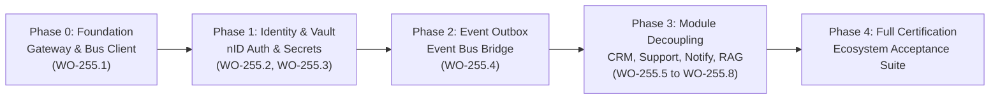

# 255 — NEWAX Ecosystem Alignment: Master Architecture & Implementation Roadmap for erp-1

> **Status: Ready for Implementation (2026-10-22)**
> **Owner:** NEWAX Engineering & Architecture
> **Document of Record for:** `erp-1` alignment with [`ECOSYSTEM.md`](../../ECOSYSTEM.md)
> **Precedents:** [`00-HOUSE-RULES.md`](../00-HOUSE-RULES.md), [`CLAUDE.md`](../../CLAUDE.md), [`README.md`](../../README.md), [`213-partner-fact-exchange.md`](./213-partner-fact-exchange.md), [`18-identity-verification.md`](../access-control-identity/18-identity-verification.md), [`161-sso-identity-federation.md`](../access-control-identity/161-sso-identity-federation.md).

---

## 1. Executive Summary & Objective

`ECOSYSTEM.md` defines the architectural contract governing the seven repositories of the NEWAX ecosystem: `nID`, `core-newax`, `erp-1`, `newcom`, `Communicator`, `harvester`, and `AegisDesk`.

Under this contract:
1. **The Core Rule:** No repo calls another repo directly. Inter-repo communication happens exclusively through `core-newax`'s **Module Gateway** (synchronous RPC) and **Event Bus** (asynchronous events).
2. **Identity & Secrets:** `nID` is the single source of truth for identity (login, MFA, OAuth sessions) and boot-time secrets (vault).
3. **Domain Ownership:** `erp-1` owns the core commercial engine — **Catalog, Orders, Fulfillment, Inventory, Finance/Accounting, and HR/People**.
4. **Boundary Guardrails:** `erp-1` must **never** own customer messaging/CRM, customer support ticketing, marketing campaign automation, identity verification infrastructure, or conversational AI/RAG.

This document establishes the **end-to-end, phased implementation roadmap** for `erp-1` to reach 100% architectural and operational alignment with `ECOSYSTEM.md` without breaking standalone operation, enterprise resilience, or the strict Definition of Done.

---

## 2. Current State Audit & Boundary Analysis

An audit of `apps/api/src/modules/` in `erp-1` reveals the following alignment matrix:

### 2.1 Modules Properly Owned by erp-1 (Retain & Harden)
| Domain | Modules | Core Capability |
|---|---|---|
| **Sales** | `cart`, `checkout`, `orders`, `pos`, `pricing`, `promotions`, `giftcards`, `wallet`, `loyalty`, `reviews`, `wishlist`, `stitching`, `shipping`, `tracking` | Order lifecycle, cash/card/COD checkout, tailor queues, customer ledger. |
| **Merchandising** | `catalog`, `collections`, `content`, `custom-fields`, `embeds`, `entity-attributes`, `fragments`, `metadata-forms`, `search`, `recommendations` | Products, variants, bilingual content, product search index. |
| **Supply Chain** | `inventory`, `purchasing`, `transfers`, `production`, `bom`, `planning`, `tradingpartners`, `marketplace`, `resilience` | Double-entry stock ledger, POs, vendor compliance, partner fact exchange. |
| **Money** | `accounting`, `receivables`, `settlements`, `finance`, `tax`, `bankfacilities`, `reports`, `analytics` | General ledger, journal entries, payments, financial statements. |
| **People** | `hr`, `payroll`, `attendance`, `orgstructure`, `organization`, `tasks` | Employee records, salary slips, attendance logs, department trees. |
| **System (Internal)** | `settings`, `feature-flags`, `managed-services`, `bpmn-workflows` | Deployment configuration, feature switches, workflow execution. |

### 2.2 Misplaced Modules in erp-1 (Decouple & Migrate)
| Misplaced Module | Current Location in `erp-1` | Target Ecosystem Repo | Migration Strategy |
|---|---|---|---|
| **CRM & Segments** | `apps/api/src/modules/customers/crm` | `Communicator` | Decouple local CRM services; forward contact state to Communicator via Event Bus; replace internal RFM scoring with external query facade. |
| **Support Tickets** | `apps/api/src/modules/customers/support` | `Communicator` | Delegate support ticket creation, routing, and resolution to Communicator; retain read-only order context link. |
| **Notifications & Preferences** | `apps/api/src/modules/customers/notify`, `notification-preferences` | `Communicator` & `newcom/esp` | Keep internal transactional channel adapters (`NotificationChannel`), route outbound marketing and non-critical push/email through Communicator / `esp`. |
| **On-Site Messages** | `apps/api/src/modules/customers/onsitemessages` | `Communicator` | Move live chats, popups, and banners to Communicator's front-end widget embed. |
| **Marketing Campaigns** | `apps/api/src/modules/merchandising/marketing` | `newcom/campaign-service` / `Communicator` | Eliminate 3-way duplication; decommission local campaigns in favor of ecosystem broadcast service. |
| **Identity Verification** | `apps/api/src/modules/system/identity-verification` | `nID` | Convert to thin REST/webhook client invoking nID external API (`POST /v1/subjects`, `POST /v1/cases`). |
| **Users & Passwords** | `apps/api/src/modules/system/users`, `apps/api/src/core/auth` | `nID` | Adopt `nID` OAuth 2.0 / OIDC code exchange (`nid_account_id` foreign key); phase out local BCrypt password storage for staff/customers in ecosystem mode. |
| **RAG / AI Embeddings** | `apps/api/src/modules/system/rag` | `Communicator` | Decouple conversational vector store into Communicator, retaining `erp-1`'s internal `AiService` pluggable provider for commercial operations. |

---

## 3. The Four Laws of Ecosystem Coexistence

To ensure `erp-1` adheres to `CLAUDE.md` and `00-HOUSE-RULES.md` while integrating into the ecosystem, every implementation phase must obey four principles:

1. **Survivably Autonomous (Dual-Mode Operation):**
   `erp-1` must remain fully bootable and testable both as a standalone single-tenant ERP (e.g. for disconnected local deployments, offline POS, or CI test suites) and as an ecosystem node. Ecosystem integration is toggled via environment configuration (`ECOSYSTEM_ENABLED=true`), not by hardcoded couplings.
2. **Zero Direct Repo-to-Repo Coupling:**
   No `erp-1` controller or service may issue direct HTTP/gRPC requests to Communicator, nID, or newcom directly. All synchronous queries go through the `ModuleGatewayClient`, and all mutations publish events to the `EventBusClient`.
3. **Transactional Outbox for Guaranteed Delivery:**
   Inter-repo events must never be dispatched synchronously within a database transaction. They must be written to `OutboxEvent` in PostgreSQL and dispatched asynchronously with exponential backoff and dead-letter queueing.
4. **Strict Data Ownership Boundaries:**
   `erp-1` stores business records (orders, inventory, general ledger). It never stores customer chat logs, email templates, broadcast recipient lists, or raw KYC document binaries.

---

## 4. Phased Implementation Roadmap



---

## 5. Detailed Work Orders (WO-255.1 to WO-255.8)

### WO-255.1: Ecosystem Gateway & Event Bus Client Foundation
- **Goal:** Provide unified client interfaces for `core-newax` Module Gateway and Event Bus.
- **Scope:**
  - Create `packages/shared/src/ecosystem/` or `apps/api/src/core/ecosystem/`:
    - `EcosystemModuleGatewayClient`: wrapper for invoking registered services through `core-newax` with HMAC authorization, timeouts, and fallback circuit-breakers.
    - `EcosystemEventBusClient`: contract for publishing and subscribing to cross-repo events (`@newax/events`).
  - Config contracts in `.env.example`:
    - `ECOSYSTEM_ENABLED=false` (boolean)
    - `ECOSYSTEM_GATEWAY_URL=http://localhost:4000/v1/gateway`
    - `ECOSYSTEM_GATEWAY_KEY=...`
    - `ECOSYSTEM_EVENT_BUS_URL=http://localhost:4000/v1/events`
- **Acceptance Criteria:**
  - Unit tests verifying mock gateway responses, timeout handling, and signed headers.
  - Zero impact when `ECOSYSTEM_ENABLED=false`.

### WO-255.2: nID Single Sign-On & OAuth Authentication
- **Goal:** Implement the reference authorization-code exchange with `nID` following the `newcom/esp` (`esp/nid_auth.go`) pattern.
- **Scope:**
  - Leverage `apps/api/src/core/auth/sso.service.ts` and `identity-provider.ts`.
  - Add `User.nidAccountId` (nullable unique string) in `schema/core.prisma`.
  - Implement `NidIdentityProvider` implementing `IdentityProvider`:
    - Handles OAuth 2.0 authorization code flow with PKCE (`state`, `nonce`, `code_verifier`).
    - Exchanges code for nID token pair, queries nID `/v1/userinfo`, matches or provisions local `User` with `nidAccountId`.
  - Provide automatic session synchronization and token validation.
- **Acceptance Criteria:**
  - Full Jest test suite covering authorization redirect, callback verification, token exchange, and account matching.
  - Existing local password login remains active as fallback when configured.

### WO-255.3: nID Boot-Time Secrets Vault Integration
- **Goal:** Fetch scoped runtime environment variables from nID Secrets Vault at startup.
- **Scope:**
  - Create a pre-bootstrap configuration loader (`apps/api/src/core/config/vault-loader.ts`).
  - When `NID_VAULT_ENABLED=true`, authenticate with `NID_SERVICE_ID` + `NID_SERVICE_SECRET`, fetch secrets for `erp-1`, and inject them into `process.env` before NestJS bootstrap.
  - Ensure fallback to local `.env` if vault is unreachable in development.
- **Acceptance Criteria:**
  - Integration test verifying graceful startup with valid vault response and safe fallback with descriptive warning when offline.

### WO-255.4: Transactional Outbox to core-newax Event Bus Bridge
- **Goal:** Automatically publish `erp-1` outbox events to the `core-newax` event bus.
- **Scope:**
  - Extend `apps/api/src/core/events/outbox.dispatcher.ts`:
    - After local subscribers receive the event, if `ECOSYSTEM_ENABLED=true`, dispatch event payload to `EcosystemEventBusClient`.
    - Support event filtering so only external domain events (`order.placed`, `order.fulfilled`, `inventory.depleted`, `goods.received`, `invoice.issued`) bridge to the ecosystem bus.
  - Maintain idempotent dispatch tracking (`OutboxEvent.ecosystemDispatchedAt`).
- **Acceptance Criteria:**
  - Automated tests ensuring network failures in the ecosystem bus bridge do not roll back the local transaction or crash the outbox loop.

### WO-255.5: Decouple & Facade Misplaced Customer Modules (CRM, Support, Notify, OnsiteMessages)
- **Goal:** Relieve `erp-1` of maintaining customer CRM, support ticketing, and bulk messaging infrastructure.
- **Scope:**
  - Mark `customers/crm`, `customers/support`, `customers/notify`, `customers/onsitemessages` as removable sector/deployment modules.
  - Implement adapter interfaces:
    - `SupportTicketBridge`: redirects ticket creation to Communicator via Event Bus (`support.ticket.created`).
    - `CustomerEngagementBridge`: delegates customer interaction histories to Communicator.
  - Ensure the admin UI renders an embed or deep-link to Communicator when `ECOSYSTEM_ENABLED=true`.
- **Acceptance Criteria:**
  - `MODULES` allowlist in `core/config/modules.ts` can exclude `crm`, `support`, `notify`, `onsitemessages` without breaking order checkout or user management.

### WO-255.6: Decouple Marketing Campaigns Module
- **Goal:** Decommission local campaign execution in favor of Communicator/newcom.
- **Scope:**
  - Retire `apps/api/src/modules/merchandising/marketing` campaign dispatch logic.
  - Export catalog discount rules and promotions as pure data models via `promotions` module, while audience targeting and dispatch belong to Communicator.
- **Acceptance Criteria:**
  - Clean separation: promotions/discounts remain in `erp-1`; email/SMS broadcast triggers route to Communicator.

### WO-255.7: Align Identity Verification Module with nID External Platform
- **Goal:** Ensure `identity-verification` conforms exactly to nID's external API contracts as defined in Doc 18.
- **Scope:**
  - Audit `apps/api/src/modules/system/identity-verification`:
    - Ensure all calls route through `NidVerificationProvider` using HTTPS + API Key.
    - Guarantee zero local KYC document storage; only reference `nidCaseId` and `nidSubjectId`.
    - Provide verified webhook receiver for nID status callbacks (`kyc.approved`, `kyc.rejected`).
- **Acceptance Criteria:**
  - Passes full test suite in `apps/api/src/modules/system/identity-verification/`.

### WO-255.8: Decouple RAG & Maintain Pluggable AI Service Extension Points
- **Goal:** Move customer-facing conversational RAG to Communicator while keeping ERP-specific operational AI clean.
- **Scope:**
  - Retain `AiService` in `apps/api/src/core/ai` for catalog classification, reorder predictions, and transaction anomalies.
  - Deprecate conversational customer support embeddings in `system/rag`, migrating knowledge base embeddings to Communicator.
- **Acceptance Criteria:**
  - No vector database requirement for core ERP installation; AI features remain optional extensions per House Rule 7.

---

## 6. Definition of Done & Verification Suite

Every work order in this roadmap must satisfy the project's strict definition of done before merging:

```bash
pnpm lint        # Zero ESLint warnings, module boundary enforcement passes
pnpm typecheck   # Clean workspace-wide TypeScript compilation
pnpm test        # All unit, integration, and E2E tests pass
pnpm build       # Full production build succeeds
pnpm index       # Generated repository index is completely up to date
```

---

## 7. Next Steps & Execution Order

1. **Review & Approval:** Stakeholder alignment on this roadmap document.
2. **Execute Phase 0:** Implement **WO-255.1** (Module Gateway & Event Bus client abstractions).
3. **Execute Phase 1:** Implement **WO-255.2** (nID SSO) and **WO-255.3** (nID Secrets Vault).
4. **Execute Phase 2:** Implement **WO-255.4** (Event Bus Bridge).
5. **Execute Phase 3:** Incrementally decouple misplaced modules (WO-255.5 through WO-255.8).
